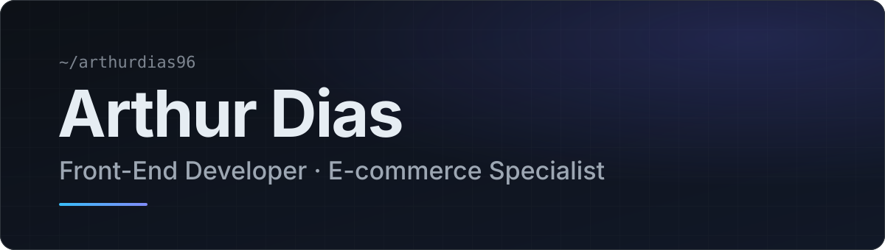
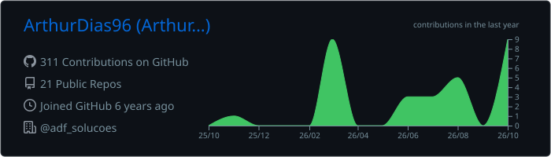
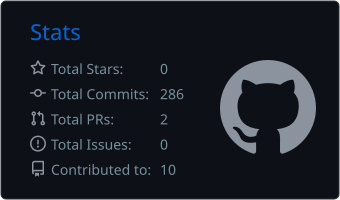
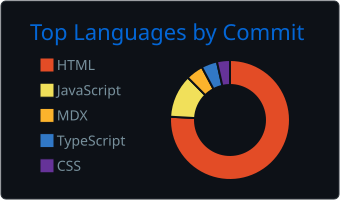

 
 

Front-end developer focused on **e-commerce and digital experiences**. 
I build fast, accessible storefronts and web apps with React, Next.js and TypeScript — and I'm growing into full stack.

 

 
 

<a href="https://www.linkedin.com/in/arthurfeerdias/">LinkedIn</a> &nbsp;·&nbsp;
<a href="https://arthurdias.vercel.app/">Portfolio</a> &nbsp;·&nbsp;
<a href="mailto:arthurfdias96@gmail.com">Email</a> &nbsp;·&nbsp;
<a href="https://adfsolucoes.com/">ADF Soluções Digital</a>

 

## About me

I'm a Front-End Developer and Tech Lead specialized in **e-commerce**, working mainly with **React, Next.js and TypeScript** on platforms like VTEX IO and Wake. My day-to-day is turning Figma layouts into reusable components, integrating APIs, fixing checkout and account flows, and keeping storefronts fast.

I'm also the founder of **[ADF Soluções Digital](https://adfsolucoes.com/)**, a digital agency delivering institutional websites, e-commerce, front-end development, integrations, migrations, maintenance and consulting.

## What I'm working on

- 🚀 Building e-commerce experiences at **ADF Soluções Digital**
- ⚡ Improving performance, UX and integrations
- 🧠 Expanding my full stack knowledge with Node.js, APIs, databases and AWS
- 💻 Creating digital products and independent projects

## Tech stack

**Frontend** 

**Backend** 

**E-commerce** 

**Tools & Cloud** 

## Featured projects

**[Zapatos — Sneaker Store](https://github.com/ArthurDias96/treinamento-ecommerce)** 
E-commerce storefront with home, product detail page (gallery, size selector, quantity, reviews), mini cart, auth modal and recently viewed products, consuming product data through a typed API service. 
`React` `TypeScript` `Vite` `CSS Modules`

**[Rede Autoestima-se](https://github.com/redeautoestimases/rede-autoestimase)** 
Institutional portal for a mental health organization, with service requests, initiatives, transparency and donation pages, and internationalization. 
`Next.js` `TypeScript` `Sass` `next-intl`

**[ADF Hub](https://github.com/ADFSOLUCOES/hub-adf)** — *in progress* 
Internal management platform for ADF Soluções, with an authenticated dashboard built on the App Router and a typed data layer. 
`Next.js` `React` `TypeScript` `Tailwind CSS` `Prisma` `PostgreSQL` `Zod`

## Professional focus

`E-commerce` &nbsp; `Front-End` &nbsp; `Performance` &nbsp; `UX` &nbsp; `APIs` &nbsp; `Full Stack Journey`

## GitHub stats

  

  
  

## Let's build something great

Open to freelance projects and e-commerce improvements focused on performance and UX.

[LinkedIn](https://www.linkedin.com/in/arthurfeerdias/) &nbsp;·&nbsp; [Portfolio](https://arthurdias.vercel.app/) &nbsp;·&nbsp; [arthurfdias96@gmail.com](mailto:arthurfdias96@gmail.com) &nbsp;·&nbsp; [ADF Soluções Digital](https://adfsolucoes.com/)
